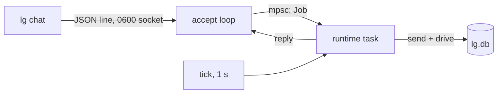

# ADR 0001: one daemon, one SQLite file

## Status

Accepted, 2026-11-06.

## Context

littleguy serves one person. It must survive a crash without losing a turn,
and it must run on a laptop with no database server. autumn-harvest offers a
Postgres backend and an embedded SQLite backend
(`autumn-harvest-sqlite`), and the agent crate supports both.

## Decision

- The daemon runs the embedded SQLite backend. One process owns the file.
- The runtime takes `<db>.lock`, so a second daemon fails to start.
- Clients talk to the daemon over a private Unix socket. They never open the
  database.
- One task owns the runtime. The accept loop hands it each request over a
  channel, so ops run one at a time.

## Consequences

- No database to install. The whole state is one file and its WAL.
- One writer. A second machine needs Postgres mode, planned for a later
  milestone behind a feature.
- The SQLite backend has no `LISTEN`, so a tick drives the assistant once a
  second. Durable timers fire within a second of their deadline.
