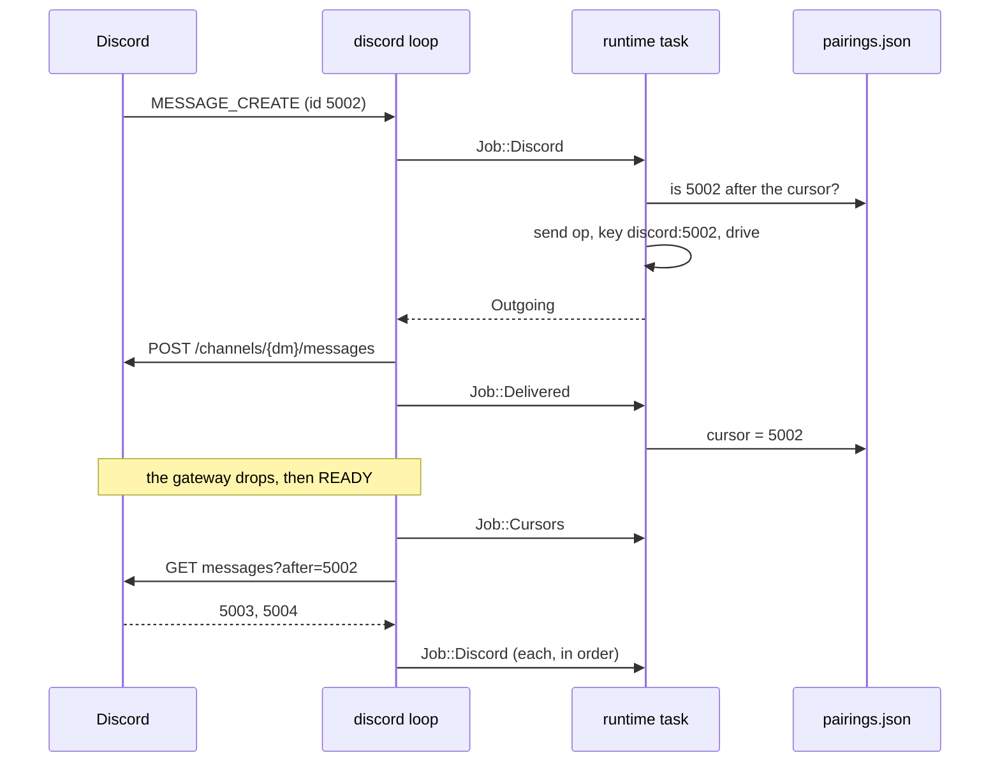

# ADR 0002: pairing codes and replies sent once

## Status

Accepted, 2026-11-06.

## Context

A Discord bot takes direct messages from anyone. littleguy serves one owner
and the people the owner trusts. The owner must let a person in without
editing a file or restarting the daemon.

The gateway drops. The daemon restarts. Discord does not replay a message
that arrived while no session was open. A message can also arrive twice:
once live, and once from a history read after a reconnect.

## Decision

### Pairing

- A sender that no rule allows gets a pairing code, when the channel allows
  pairing. The code is 8 Crockford base32 characters, shown as `XXXX-XXXX`.
  It holds 40 random bits from the operating system.
- A code lasts 10 minutes and works once. A sender that asks again gets the
  same live code. At most 32 codes are live, so a flood of strangers cannot
  grow memory.
- The owner redeems a code with `lg pair <code>` on the local socket. The
  daemon checks the peer credentials, so only its own user may pair.
- `issue_decision` and `is_live` in `formal/verus/src/pairing.rs` prove the
  reuse, cap and expiry rules. `verus_mirror` keeps the Rust copy equal.
- Codes live in memory. A restart drops them, and the stranger asks again.

### Replies sent once

- The Discord message id is the idempotency key of its op, as
  `discord:<snowflake>`. A message that arrives twice runs once.
- `pairings.json` keeps, per sender, the DM channel and the last message
  whose reply went out. The cursor only moves forward, after a send
  succeeds.
- On each `READY`, the daemon reads the history after each cursor, oldest
  first, and handles each message.
- A message at or before the cursor gets no reply. A duplicate after the
  cursor resends the stored answer. It never runs the model again.

## Consequences

- No double reply after a reconnect or a restart, and no double model call.
  `discord_pairs_answers_and_backfills_once` proves it against a fake
  Discord.
- When the send for one message fails and the send for a later message
  succeeds, the cursor passes the first. Its reply is lost. The owner sees a
  warning in the log.
- A sender from the config file has no DM channel until their first message
  arrives. A message they send while the daemon is down, before any other,
  is not read back.
- One history read takes 100 messages per sender. A longer outage answers
  the oldest 100.
- Only direct messages count. Guild messages and bot messages are skipped.
