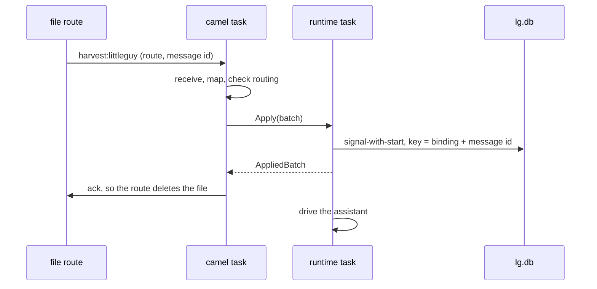

# ADR 0003: camel routes feed the assistant

## Status

Accepted, 2026-11-08.

## Context

An always-on agent should notice the world: a file dropped in a folder, a
timer, and later a mailbox or a queue. rust-camel has the connectors.
harvest-camel 0.4 bridges camel into a harvest runtime, and its `sqlite`
feature feeds a `SqliteRuntime` that the caller owns.

The daemon has one writer. One task owns the runtime (ADR 0001), so the
bridge must not hold the runtime while it waits for a message.

## Decision

- Each `[[camel.route]]` in `lg.toml` is one camel route. It reads from
  `file:` or `timer:`. littleguy registers only those components.
- Every route ends in one stream, `harvest:littleguy`. The route sets
  `LittleguyRoute` to its id, and `LittleguyMessageId` to a stable id: a
  file path and modification time, or a timer name and fire time.
- One connector binding, `littleguy-camel`, maps each message to an
  `AgentOp` message for the assistant. It is a signal-with-start onto the
  agent workflow, keyed by the binding, the signal and the message id.
- The mapper checks each message against the routing table. The camel
  channel allows `camel:<id>` for each route of the config, and no one else.
- `SqliteInbound` splits each pass in three. The camel task receives and
  maps. The runtime task applies the batch, then drives the assistant. The
  camel task settles: ack, abandon or dead-letter.
- A dead letter goes to `harvest_connector_dead_letters` in `lg.db`.

## Consequences

- A file reaches the assistant once. The ack follows the durable write, so a
  crash before it leaves the file for the next poll, and the key dedupes it.
- A route with `noop=true` reads every file again after a restart. Each one
  dedupes, so the model is not called again.
- A body that is not UTF-8 is poison. It is a dead letter on its first
  delivery and never reaches the model.
- The answer stays in the assistant state and the log. Sending it somewhere,
  such as a Discord DM, is later work.
- Request and reply (`harvest-external:`) is not available on SQLite until
  autumn-harvest#2607.
- harvest-camel links autumn-harvest-plugin, which builds autumn-web with its
  default features. The build is larger and slower.
