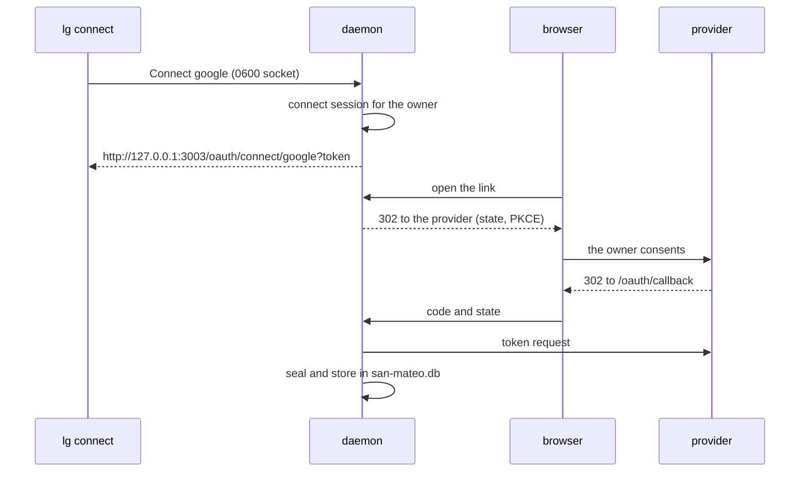

# ADR 0004: OAuth connections with San Mateo

## Status

Accepted, 2026-11-08.

## Context

Mail and calendar tools (M4) need OAuth tokens that stay valid for months.
That means a sealed store, a refresh before expiry, and a browser flow to
connect an account. San Mateo does all three, and `san-mateo-sqlite` keeps
its data in one SQLite file with no server.

## Decision

- `lg serve` embeds San Mateo when `lg.toml` has a `[san_mateo]` section.
  Its data lives in `san-mateo.db`, next to `lg.db`. It has its own file, so
  its writer never contends with the harvest runtime lock.
- The sealing key comes from `LG_SAN_MATEO_KEY` only. A client secret comes
  from the variable that `client_secret_env` names. The config file holds
  no secret.
- The connect pages and the OAuth callback listen on a loopback address. The
  config refuses any other address.
- The REST API needs a secret key. The daemon makes a fresh one at each
  start and never shows it, so only the daemon itself calls the API.
- At each start, the daemon adds or updates each integration of the config.
  A stored key with another provider is an error, so a typo cannot move a
  connection to a different provider.
- `lg connect <integration>` asks the daemon over the private socket. The
  daemon makes a connect session for the owner and returns a link that goes
  straight to the provider. Only the owner of the daemon may connect, list
  or disconnect.
- The background loop refreshes tokens. It does not run San Mateo syncs.

## Consequences

- A connection survives a restart. Without the key, the file opens nothing.
- A lost `LG_SAN_MATEO_KEY` loses every token. The owner connects again.
- The tools that use the tokens come in M4. This milestone only keeps them.
- The browser must run on the machine of the daemon, because the callback
  is on loopback. A remote daemon needs an SSH tunnel to that port.
