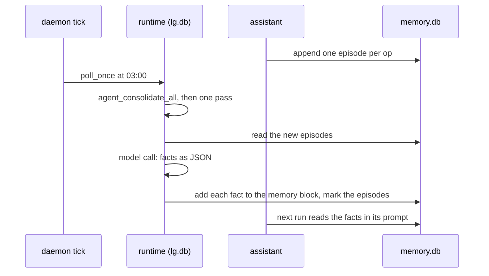

# ADR 0005: memory and nightly consolidation

## Status

Accepted, 2026-11-09.

## Context

A personal agent must remember what the owner tells it. autumn-harvest-agent
0.10 has the parts: memory blocks in the prompt, a `memory` tool, an episode
log of each op, and a consolidation pass that turns episodes into facts. It
ships the memory store and the episode store in process memory only
(autumn-harvest#2604). The pass needs both stores, because its facts go into
the memory of the agent.

`AgentMemory::State` keeps notes in the agent state with no store. The pass
refuses that mode, so it does not fit.

## Decision

- A new crate, `littleguy-stores`, keeps both stores in one SQLite file,
  `memory.db`, next to `lg.db`. It has its own file, so the runtime stays the
  one writer of `lg.db` (ADR 0001).
- The engine owns the rules. A memory edit calls `memory::apply_to`, and an
  episode change calls `EpisodeLog`. The store keeps their results, one
  transaction per call. A property test runs random edits on this store and
  on the engine's `InMemoryMemoryStore`, and asserts the same answers.
- Each edit key applies once, and a failed edit keeps its failure. A
  retried tool call after a crash therefore changes nothing.
- The assistant profile takes `AgentMemory::Store` and
  `EpisodeSettings::default()`. The `[memory]` section can turn memory off.
- One engine schedule in `lg.db` starts `agent_consolidate_all` on a cron
  expression in an IANA time zone, 03:00 UTC by default. The daemon tick
  calls `poll_once`, which fires a due schedule. The harness gets the SQLite
  agent directory, so the dispatcher finds the assistant.

## Consequences

- A note survives a restart, and the next run reads it.
- A night with no new episode costs no model call.
- The pass runs only while the daemon runs. After a gap, the schedule fires
  once, then counts its next slot from then.
- A bad cron field or time zone fails `lg serve` at start, with a message
  that names `memory.consolidate`.
- When the engine ships durable stores (#2604), littleguy can move to them
  and drop this crate. The file format then needs a one-time copy.
