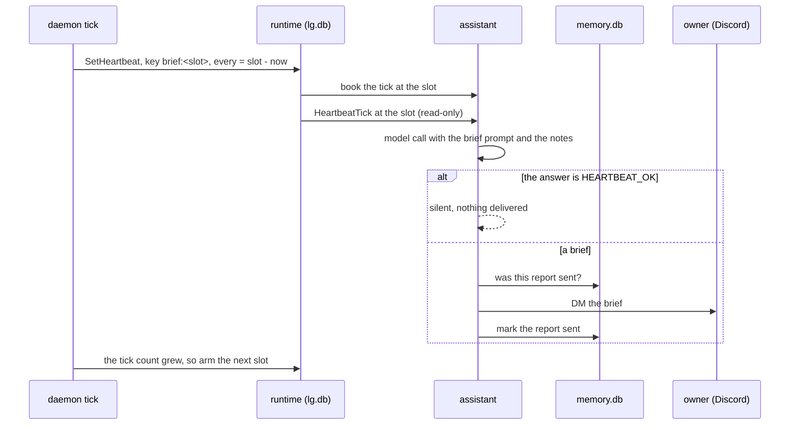

# ADR 0006: the morning brief

## Status

Accepted, 2026-11-09.

## Context

The owner wants a short brief on weekday mornings, and no message on a
quiet day. autumn-harvest-agent 0.10 has most of the parts. A heartbeat
tick is an unattended, read-only op with its own prompt. An answer of
`HEARTBEAT_OK` is silent: the engine keeps it out of the transcript and
delivers nothing. Any other answer goes to the harness `Delivery`, through
a recorded activity, at least once.

Two parts are missing:

- The heartbeat runs on an interval only. It has no calendar, so it cannot
  skip a weekend or follow a time zone.
- An `AgentOp::HeartbeatTick` does not decode from a signal. Only the
  engine wake hook makes one, so the daemon cannot send a tick itself.

## Decision

- A `[brief]` section names a cron `schedule` in an IANA `timezone`, the
  `prompt`, and the Discord user `to`. The default is 07:30, Monday to
  Friday, in the memory time zone.
- The daemon keeps the calendar. It aims the engine timer at the next slot
  with one `Control::SetHeartbeat` per slot. The custom heartbeat has the
  brief prompt, and its interval is the time from now to the slot. The
  control resets the booked tick, so the engine books the tick at the slot.
- The op key is `brief:<slot>`, so a slot is armed once, also when a
  restarted daemon arms it again.
- After a slot, the daemon waits for the tick count of the agent to grow.
  It then arms the next slot, because the engine books the next tick one
  interval later. A tick that does not come within one hour does not hold
  the calendar: the daemon then arms the next slot.
- The profile sets `deliver`. `BriefDelivery` ignores every report that is
  not a heartbeat, because the channels send those answers. It sends a
  brief as a Discord DM to `to`, and keeps the report key in `memory.db`,
  so a repeated delivery sends no second DM.
- The engine refuses an interval under 60 seconds. A slot that close runs
  up to one minute late.

## Consequences

- The engine runs the brief as a heartbeat, so it stays read-only and out
  of the chat transcript, and the answer reaches the owner once.
- A slot that passes while the daemon is down fires once, at the next
  start, because its timer is durable. The daemon then arms the next slot.
- Each arm is one control op. Each slot costs one model call, also on a
  quiet day.
- When the engine gets a calendar heartbeat or an external tick, the
  daemon can drop the calendar and set the schedule in the profile.
