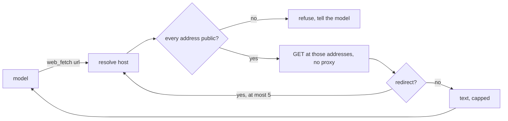

# ADR 0007: the first tools

## Status

Accepted, 2026-11-09.

## Context

The assistant had one tool, `memory`. M3 gives it tools. The engine has
the parts: the `Tool` trait with an effect and flow labels, persistent
workspaces kept as snapshots in a `WorkspaceBlobs` store, and
`DirWorkspaceBlobs` on disk. It has no web tools and no MCP client.

A web tool runs on the owner's machine. A page or a prompt can name any
URL. A fetch that follows it could read the router, a cloud metadata
service such as `169.254.169.254`, or a local daemon. This is server-side
request forgery.

M3 is large, so it ships in three parts. This ADR covers M3.1: web fetch,
web search and workspace files. M3.2 adds a sandboxed shell and approval
buttons. M3.3 adds an MCP client and flow rules.

## Decision

- A new crate, `littleguy-tools`, holds the tools. `[tools]` turns each one
  on or off. Each is on by default.
- `web_fetch` reads one http or https page.
  - It resolves the host itself. One address that is not public refuses
    the URL. The request then goes to those exact addresses, so a second
    lookup cannot swap in a private one (DNS rebinding).
  - It follows each redirect by hand, at most five, and checks each hop.
  - It refuses a URL with a user name or password, and a body that is not
    text. It reads at most 2 MiB, and returns at most `fetch_max_chars`
    characters. A small pass turns HTML into lines of text.
  - It sends no request through a proxy, because a proxy resolves the host
    again.
- `littleguy-core::addr` decides which address is public. The IPv4 kernel
  `is_public_v4` is proved in `formal/verus/src/addr.rs`: it allows an
  address exactly when no blocked range holds it. A property test checks
  it against a prefix model. IPv6 follows the IPv4 address that it carries
  (mapped, NAT64, 6to4), and refuses the local blocks.
- `web_search` asks the Brave Search API. The key comes from
  `LG_BRAVE_API_KEY` only. Without it there is no search tool. The `Debug`
  form of the tool leaves the key out.
- Both web tools are `ReadOnly` and carry the `untrusted_input` label, so
  M3.3 flow rules can fence what follows them. An interrupt may stop them.
- `read_file`, `write_file`, `list_files` and `delete_file` work on the
  persistent workspace of the assistant. The snapshots live in
  `workspace/` beside `lg.db`. The engine saves a change only after a
  successful call, and checks that each path stays inside the workspace.
  Writes are `Internal`, reads are `ReadOnly`.
- A tool failure that the model can act on is a `Tool` error, which never
  retries. A search rate limit or a server fault retries.

## Consequences

- A page cannot make the assistant read a private address, also through a
  redirect or a rebinding DNS answer.
- The owner cannot fetch a page on the home network. A later allow list in
  `[tools]` can add that.
- An owner behind a proxy gets no `web_fetch`.
- The heartbeat of the morning brief is read-only, so it can fetch and
  search, but cannot write a file.
- The workspace survives a restart. It is not encrypted at rest, because
  the engine codecs are the identity by default.
