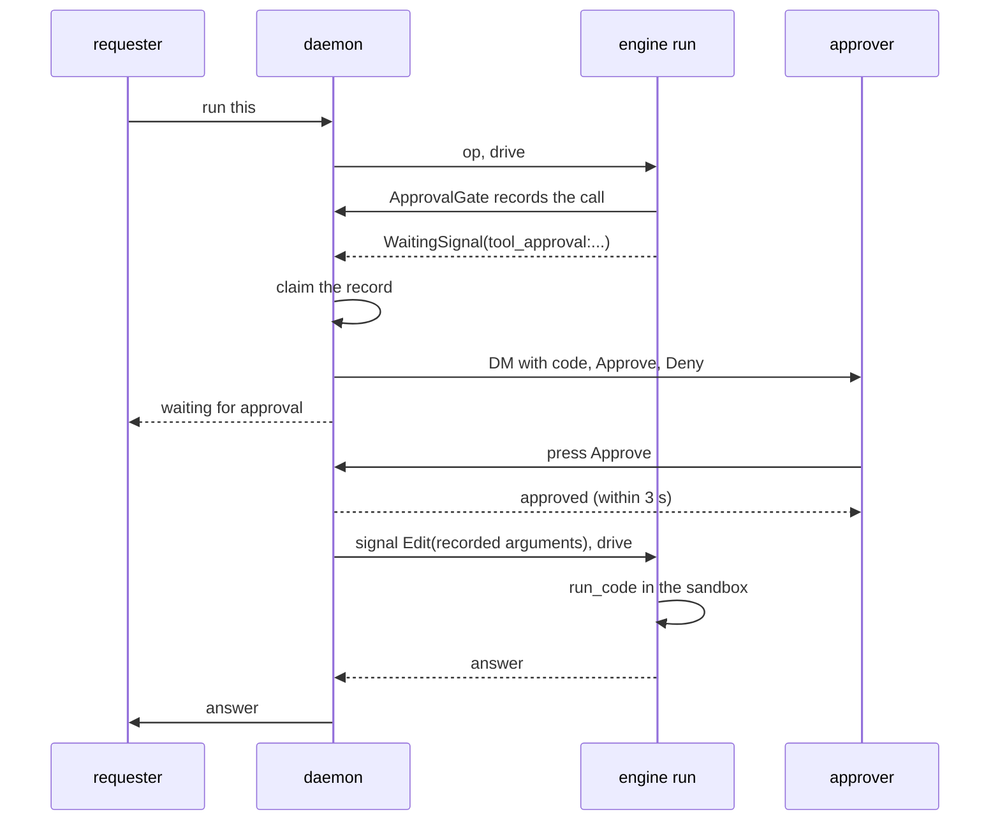

# ADR 0008: a sandboxed shell behind approvals

## Status

Accepted, 2026-11-09. [ADR 0009](0009-mcp-and-flow-rules.md) moves the
approver and the deadline to `[approvals]`.

## Context

M3.2 gives the assistant a shell. Code that a model writes can delete
files, read secrets or call out to the network. So each run needs two
guards: a boundary around the code, and a person who says yes first.

The engine has both parts. `autumn_harvest::sandbox` runs code on a
`SandboxRuntime`: a new Firecracker microVM for each run, or a host process
for development. `SandboxTool` turns it into the `run_code` tool, and history
records each outcome, so a replay never runs the code again. A `ToolPolicy`
can answer `RequireApproval`. The run then waits on one signal per call,
with a deadline, and a decision is an `Approval` payload.

Three gaps remain:

- The engine names the wait (`tool_approval:<round>:<position>:<call id>`).
  Nothing shows the arguments of the waiting call. The agent state holds
  the transcript only after an op ends.
- The engine has no approval notice (autumn-harvest #2603).
- While a call waits, the next op of the assistant waits behind it. The
  state keeps only the last answer, so the daemon cannot tell which answer
  belongs to which message.

## Decision

- `[sandbox]` turns the tool on. `backend = "firecracker"` needs a
  `[sandbox.firecracker]` section and runs behind the jailer with the
  engine default policy: microVM isolation, no network. `backend =
  "process"` accepts process isolation, for development only. `network`
  defaults to `false`.
- `ApprovalGate` is the tool policy. It asks before each `run_code` call
  and allows every other tool. The policy runs inside the model-turn
  activity, so it records the call with its arguments in `memory.db`
  before the wait starts. A call that does not save is denied.
- After each drive, the daemon reads the wait of the run. A new wait claims
  the newest unclaimed record of its call id, with the requester. The
  approver gets a Discord DM with the code and two buttons, once. The owner
  can also run `lg approvals`, `lg approve <n>` and `lg deny <n>`.
- An approval sends `Approval::Edit` with the recorded arguments. So the
  call runs with exactly the code that the approver read, even when a model
  reuses a call id. A record with no arguments can only be denied.
- Only the configured approver may press a button. A press gets its answer
  before the run moves on, because Discord waits three seconds.
- While a call waits, the daemon starts no new op. `lg chat` gets a busy
  answer. A Discord message is held in memory and runs after the decision.
  The delivery cursor does not move for a held message, so a restart reads
  it again.
- When a wait ends by a decision or by its deadline, the record closes and
  the answer goes to the requester. A deadline denies the call.
- An unattended run (a heartbeat) stays read-only. The engine refuses a
  `Write` or `External` call there, which covers code with a network or on
  the host.

## Consequences

- No code runs without a person. A timeout is a denial.
- The approver reads the exact call. The recorded arguments are the ones
  that run.
- The process backend shares the host kernel. It is opt-in by name, and the
  daemon logs a warning when it starts with it.
- A Firecracker host needs KVM, the jailer, a guest kernel and a root file
  system with the engine guest agent. littleguy does not build the image.
- The held messages live in memory. A restart drops them, and the Discord
  history read after the reconnect brings them back.
- Engine gap #2603 stays open. When the engine sends approval notices, the
  claim step can go.
