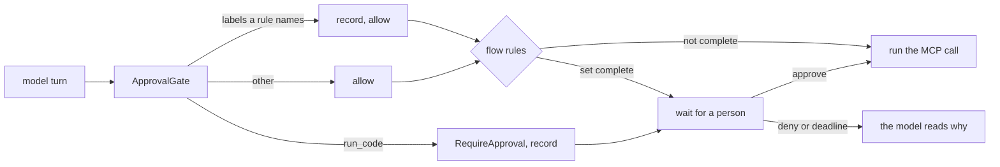

# ADR 0009: MCP servers as tools, under flow rules

## Status

Accepted, 2026-11-09.

## Context

M3.3 lets the owner add tools without a new build. The Model Context
Protocol (MCP) is the common way to ship a tool server: GitHub, a mail
bridge, a notes app. Each server is a child process that speaks MCP on
stdin and stdout, or an HTTP endpoint.

More tools bring more risk. One tool can read a stranger's email, another
can read the owner's calendar, and a third can send a message. Each call is
safe alone. Together they let a prompt injection in the email send the
calendar to the stranger. Simon Willison calls this the lethal trifecta.
The Agents Rule of Two says a run may hold at most two of untrusted input,
private data and an outside effect without a person.

What the engine has:

- No MCP client. `autumn_harvest::remote_task` holds durable MCP Tasks
  calls only.
- Flow rules (`autumn_harvest_agent::flow`). Each tool carries labels and an
  effect. The workflow records the labels of every call that it lets run,
  across ops. `FlowRules::rule_of_two()` asks a person before the call that
  completes the three.
- The approval wait of M3.2. A flow rule that asks uses the same wait as
  `run_code`.

One gap: the flow check runs inside the engine, after the tool policy. The
policy cannot see the labels that the run holds. So the policy of M3.2
cannot know in advance which call a flow rule will hold, and it records no
arguments for that call.

## Decision

- **The client is rmcp 3.9**, the official Rust MCP SDK. littleguy-tools
  uses its client, the child-process transport and the streamable HTTP
  transport on reqwest 0.13 with ring rustls, as the web tools do.
- **`[[mcp.server]]`** names one server: `command` and `args`, or `url`.
  The config sets the `labels` and the `effect` of each tool of the server.
  The server cannot set them, because a server must not choose its own
  trust. The effect defaults to `external`, the strictest. `tools` keeps
  only the named tools.
- **Each tool is `<server>__<tool>`.** A character that a model provider
  does not take becomes `_`. A name over 64 bytes is left out, not cut,
  and so is a second tool with a name already taken. The log says which.
- **A child gets a clean environment**: `PATH`, `HOME` and the variables
  that `env` names. So a server never sees the Discord token or a model
  key. `bearer_env` names the variable of the bearer token of a URL. A URL
  that carries a token must use https, or http to this machine.
- **A failed server costs its tools, not the daemon.** `lg serve` opens
  each server before the harness is built, and logs a server that fails.
- **A call is never sent twice.** A call that fails on a closed connection
  may have run, so it fails, and the next call opens a new connection.
  A call has a bound (`timeout_secs`, 60 by default).
- **`[flow]` turns the Rule of Two on by default.** `recheck =
  "each_call"` asks before each call that touches a complete set.
  `"until_approved"` asks once per op.
- **`[approvals]` holds the approver and the deadline** for every wait,
  from `run_code` or a flow rule. They move out of `[sandbox]`. M3.2 has
  not shipped, so no config breaks.
- **The gate records each call that a rule may hold.** `ApprovalGate`
  records each call whose tool carries a label of an `Ask` rule, with its
  arguments, and lets it pass. When the engine then holds the call, the
  daemon claims that record as for `run_code`. A record that no wait
  claims is never shown, and the store drops it later.
- **The guard is on only when a rule can trip.** It needs the sandbox, or
  tools that carry every label of some rule. The default tools carry no
  private data, so a config without MCP servers opens no approval store
  for flow rules.

## Consequences

- An MCP server that reads private data and can send needs a person for
  each send, as long as the run also holds untrusted input.
- The labels persist across ops, as the engine keeps them. Once the
  assistant has read untrusted input and private data, each later write or
  outside call asks, until the transcript is cleared. littleguy has no
  command that clears it yet. Under `"until_approved"` the approver says
  yes once per op instead.
- The gate writes one row for each watched call, also for a call that never
  waits. The store keeps at most 1,000 rows, so the cost stays small.
- The trust of a server is the trust of its config. The labels describe
  what the owner knows about the server. A wrong label weakens the rule.
- Tool descriptions come from the server, and the model reads them. They
  are cut at 1,024 characters and carry the server id.
- The tool list is fixed when the daemon starts. A server that adds a tool
  needs a restart.
- Engine gap #2603 stays open. When the engine names the call of a wait,
  the gate can stop recording calls in advance.
