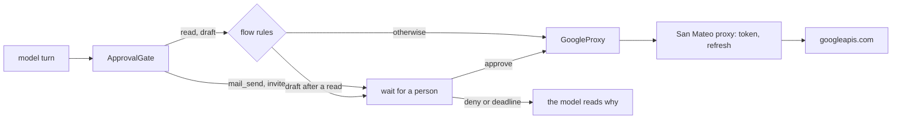

# ADR 0010: Mail and calendar tools over San Mateo

## Status

Accepted, 2026-11-09.

## Context

M4 gives the assistant the owner's Gmail and Google Calendar. M1.7 already
keeps the OAuth tokens in San Mateo, which seals them and refreshes them.
M3.2 and M3.3 already give a wait for a person and the Rule of Two.

Mail is the classic case of the lethal trifecta. A stranger writes the
mail, so its text is untrusted input. The inbox and the calendar are
private data. A send leaves the machine. One injected line in a mail must
not make the assistant send the calendar to the stranger.

The engine has no Google client. San Mateo has a proxy:
`SanMateo::proxy` adds the token of a connection to a request, refreshes
the token when it expires, and retries only when told to.

## Decision

- **Every call goes through the San Mateo proxy.** The `google` provider
  answers at `https://www.googleapis.com`. `GoogleProxy` in the binary picks
  the newest live connection of the owner and sends the request. The
  tools in `littleguy-tools::google` see a `GoogleApi` trait only. So no
  token ever reaches a tool, a log or the model.
- **Six tools, each with a fixed effect and fixed labels:**

  | Tool | Effect | Labels | Waits |
  |---|---|---|---|
  | `mail_search` | read only | untrusted input, private data | no |
  | `mail_read` | read only | untrusted input, private data | no |
  | `mail_draft` | write | none | when a flow rule holds it |
  | `mail_send` | external | none | always |
  | `calendar_events` | read only | untrusted input, private data | no |
  | `calendar_create` | write | none | when it invites a person |

- **A send always waits.** The gate asks before each `mail_send`, with or
  without flow rules. The approver sees the addresses, the subject, the
  thread and the whole body, as they go out.
- **An invite always waits.** An event with attendees mails each attendee,
  so it is an outside effect. An event without attendees stays in the
  owner's calendar and uses `sendUpdates=none`.
- **A draft waits under the Rule of Two.** After a read, the run holds
  untrusted input and private data. A draft is a write, so the flow rule
  holds it. A draft that the owner approves still sits in Gmail until the
  owner sends it.
- **The model writes plain fields, not a raw message.** `Mail::new` refuses
  a control character in an address or a subject, so no input adds a
  header. The body travels as base64. A proptest checks the header count.
  A reply takes `In-Reply-To` and `References` from the stored mail.
- **A Gmail id is checked** as 1 to 64 characters of `[A-Za-z0-9_-]`, so
  an id cannot change the path of a request.
- **The proxy never retries a call.** `ProxyRequest::retries` stays at 0,
  so a send that fails on the wire is not sent again by San Mateo.
- **`[google]` names one San Mateo integration** with the `google`
  provider, and turns mail and calendar on or off. The config refuses an
  unknown integration and a section with both off.

## Consequences

- The owner grants `gmail.modify` and `calendar.events`. Both are broad
  scopes. The tools use only search, read, draft, send, list and insert.
- An engine retry of the activity that runs `mail_send` can send a mail
  twice, when the first attempt reached Google and the answer was lost.
  Gmail has no idempotency key for a send. The engine retry policy of a
  tool call decides how often that can happen.
- The tool list is fixed when the daemon starts. A connection made later
  works at once, because each call looks up the connection. With no
  connection, a call fails and tells the owner to run `lg connect`.
- Mail text is cut at 20,000 characters, and a search returns at most 25
  mails, so one mail cannot fill the context.
- HTML mail reaches the model as text, through the same converter as web
  fetch.
