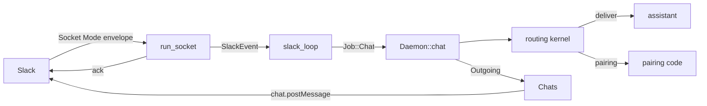

# ADR 0011: Slack over Socket Mode

## Status

Accepted, 2026-11-10.

## Context

M1.5 adds Slack as a second chat channel. The roadmap waited for
`autumn-plugin-slack` 0.4. Version 0.4.0 is on crates.io now, but it does
not fit a personal daemon:

- It serves the Events API, slash commands and interactivity on HTTP
  routes of an autumn-web app. Slack must reach those routes at a public
  HTTPS URL. littleguy runs on the owner's machine and has no such URL.
- Its README lists Socket Mode as out of scope.
- `SlackClient::new` is private to the crate. A client comes only from the
  state of a running autumn-web app, so littleguy cannot use the Web API
  client alone.

Slack Socket Mode needs no public URL. The app opens a WebSocket to Slack
with an app-level token, and Slack sends each event over it.

Until now the daemon spoke Discord only. Its pairing, delivery cursors,
approval notices, held messages and brief all named Discord.

## Decision

- **Socket Mode lives in `littleguy-channels::slack`.** `run_socket` asks
  `apps.connections.open` for a URL with the app token (`xapp-`), connects
  with tokio-tungstenite on rustls, and connects again after a drop with
  the Discord backoff: one second, doubled up to a minute. A `hello` resets
  the pause. A `disconnect` from Slack connects again at once.
- **Each envelope is acknowledged before its event moves on.** Slack
  resends an envelope without an acknowledgement. The message id stays the
  idempotency key of its op, so a resent message runs once.
- **`SlackApi` is a small Web API client** on reqwest, with the bot token
  (`xoxb-`): `chat.postMessage`, `chat.update`, `chat.postEphemeral`,
  `conversations.open` and `conversations.history`. A call is form-encoded.
  It retries once after a 429, for at most ten seconds. An answer with
  `ok: false` is an error. `Debug` shows no token.
- **A Slack message id is `slack:<channel>:<ts>`.** A `ts` is unique only in
  its channel. The delivery cursor is the `ts`. `chat::is_after` compares a
  Discord snowflake and a Slack `ts` as numbers, so the pairing store keeps
  one rule for both.
- **Every reply escapes `&`, `<` and `>`.** The model writes the replies.
  Slack reads `<!channel>` or `<@U1>` as a mention, so an unescaped reply
  could ping a workspace. This matches `allowed_mentions: []` on Discord.
- **The daemon has one path for every chat.** `Service` names Discord or
  Slack. `Chats` holds the client of each service that is on and sends a
  reply, a notice with buttons, or a brief. A sender id names its service
  (`discord:123`, `slack:U1`), so the approver, the brief target and
  `lg unpair` work on either service. `Requester::Chat` keeps the service,
  and a stored `discord:<channel>` requester still reads.
- **`[slack]` has the keys of `[discord]`**: `pairing` and `allowed`.
  `approvals.approver` and `brief.to` take `slack:<user id>`. A bare id
  stays a Discord id, so no config breaks.
- **Slack runs with both tokens set, or not at all.** One token alone is a
  mistake, and the log names the missing one.
- **A button press is acknowledged with its envelope.** The daemon then
  replaces the message with `chat.update` and empty `blocks`, so nobody can
  press again, or tells only the presser with `chat.postEphemeral`.

## Consequences

- littleguy keeps its own Socket Mode client until the plugin has Socket
  Mode and a public Web API client. Then the client here can go.
- The Slack app needs Socket Mode, the bot scopes `chat:write`,
  `im:history` and `im:write`, and the `message.im` event.
- A history read after a reconnect returns at most 100 messages per
  channel, as on Discord.
- A section block holds at most 3,000 characters. A message splits at
  2,500 characters before escapes. A notice whose last piece is still too
  long sends that piece first, then the buttons under a short line.
- The fake Slack in `littleguy-channels::testing::slack` checks both tokens,
  answers 429 and 500 on request, and records each acknowledgement. The
  daemon tests run pairing, backfill, the approval buttons and the brief
  against it.
