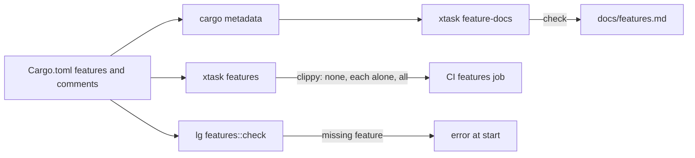

# ADR 0012: A cargo feature for each integration

## Status

Accepted, 2026-11-10.

## Context

Until now `lg` built every integration: Discord, Slack, Claude, OpenAI,
the web tools, the MCP client, the sandbox, camel routes, San Mateo and the
Google tools. An owner who uses Discord and Claude still compiled the camel
crates, San Mateo with axum, rmcp and the Firecracker backend. Each
integration added build time, binary size and supply chain surface for no
gain.

A feature flag rots in two ways. A combination stops compiling because no
build tries it. A document that says what a feature pulls in drifts from
the manifests.

## Decision

- **Each integration is a cargo feature of `lg`**: `discord`, `slack`,
  `claude`, `openai`, `web`, `mcp`, `sandbox`, `camel`, `oauth` and
  `google`. `google` turns `oauth` on. `full` turns on all of them.
- **The default set is what a chat assistant needs**: `discord`, `slack`,
  `claude`, `openai`, `web`, `mcp` and `sandbox`. `camel`, `oauth` and
  `google` are opt-in. Each one adds a large tree (camel and harvest-camel,
  San Mateo with axum), and each needs setup beyond a token.
- **The library crates have the same split.** `littleguy-channels` has
  `discord` and `slack`. `littleguy-models` has `claude` and `openai`.
  `littleguy-tools` has `web`, `mcp` and `google`; the file tools are
  always on. The workspace depends on each with `default-features =
  false`, so only `lg` picks.
- **Shared types stay in every build.** `Service`, `DmMessage`, `Button`
  and `ChannelError` have no dependency. The pairing, the routing and the
  approval code use them, so one daemon path serves every build. A send to
  a service that the build leaves out fails with `ChannelError::Off`.
- **A missing piece fails loudly.** The config parses every section in
  every build. `features::check` stops `lg serve` at start when a section
  needs a feature that the build lacks, and the error names the feature.
  `--model claude` without `claude` fails the same way. `lg connect`
  without `oauth` answers with an error that names the feature. A key that
  is on by default, such as `tools.web_fetch`, only logs, because it
  cannot tell an owner's choice from the default.
- **An uninhabited type stands in where a signature must stay.** Without
  `sandbox`, `sandbox::Runtime` is `Infallible`. Without `camel`,
  `camel::Camel` is an empty enum. `Option` of either is always `None`, so
  the compiler drops the branch.
- **The feature table is rendered, not written.** `cargo xtask
  feature-docs` reads `cargo metadata` and the comment above each feature
  in `Cargo.toml`. It follows each feature into the workspace crates and
  lists the optional crates that it adds. It fails when
  `docs/features.md` differs, and `--write` renders it again. A feature
  without a comment is an error.
- **CI builds the matrix.** `cargo xtask features` runs clippy on every
  target of each crate with no features, with each feature alone and
  with all features, warnings denied. Then it runs the tests of each crate
  with no features. The other jobs build with all features, so the tests
  and the coverage reach each integration.

## Consequences

- A build without a chat service still compiles the chat path, which has
  no caller there. Four items carry `#[expect(dead_code)]` and two carry
  `#[expect(clippy::unused_async)]` for that build only, each with its
  reason. The default and full builds check them in full.
- A test that needs an integration carries its `cfg`. The no-feature test
  run covers the error paths: a missing model, a missing chat service and
  a missing `oauth`.
- A new integration needs a feature, its comment, a row in
  `features::ALL` and a check in `features::check` if it has a config
  section.
