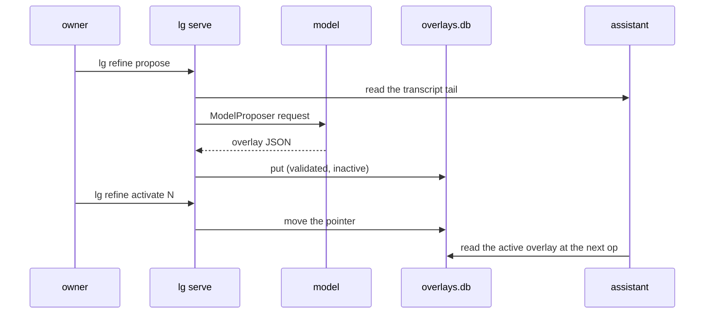

# ADR 0013: The refine loop

## Status

Accepted, 2026-11-10.

## Context

The assistant runs on one profile: the system prompt of the config, its
tools and its bounds. An owner who sees the assistant answer badly edits
the config and restarts the daemon. The engine has a better tool for this.
A profile overlay is a versioned change to a profile: a new system prompt,
guardrails, tool guidance, skills or tighter bounds. A store keeps each
version, and a pointer names the active one. A durable agent reads the
active overlay at the start of each op, so a change needs no restart.

The engine also ships a refine workflow, `agent_refine`. It reads ended
runs, asks a proposer for candidate overlays, composes them, probes each
one by replay and picks a winner. littleguy cannot use it as it stands:

- Its replay probe reads `agent_loop` runs only. The assistant is the
  durable agent `assistant/<owner>`, and `run_start` refuses such a run
  as `SourceNotReplayable`.
- It needs an `OverlayComposer`, and the engine ships none.
- It registers only under the agent feature `eval`, which turns on
  `autumn-harvest/testing`. A daemon should not ship test support.

## Decision

- **The overlay store is real; the refine workflow waits.** A `[refine]`
  section gives the assistant harness a `SqliteOverlayStore` in
  `overlays.db`, next to `lg.db`. The harness itself validates each
  overlay, so a version above the ceilings of the refine policy is never
  stored or activated.
- **One proposer call, outside a workflow.** `lg refine propose` reads the
  last `messages` messages of the assistant transcript (40 by default, at
  most 500, and at most 64 KiB). It asks the engine `ModelProposer`, over
  the model of the assistant, for one overlay of the configured dimension.
  A reply that does not decode, or does not fit the ceilings, goes back
  with its reason, up to three attempts. `KEEP_BASE` stores nothing.
- **A person activates each version.** A proposal is stored as an inactive
  version by the operator `lg-refine`. Only `lg refine activate` moves the
  pointer, as the owner. `lg refine rollback` moves it back. There is no
  auto adoption, so the engine's daily cap and approval timeout do not
  apply yet.
- **The owner can write a version too.** `lg refine put <file>` stores an
  overlay JSON file. `{}` is the config profile with no change, so an owner
  turns every overlay off by putting and activating it.
- **Every command goes through the daemon.** The daemon holds the store,
  so the socket checks that the owner sends each request, as it does for
  approvals.
- **The feature `refine` is on by default.** It adds no crate. The store
  opens only with a `[refine]` section, so a config without one runs as
  before, with no overlay read per op.

## Consequences

- A proposal is as good as one model call over the transcript. Nothing
  replays it before the owner sees it. The owner reads it with
  `lg refine show` and decides.
- The transcript can hold private data. The proposal goes to the model of
  the assistant, which saw the same data. An overlay can quote that data
  into the system prompt, and the owner sees it before activation.
- When the engine probes durable agent runs and ships a composer outside
  `eval`, `lg refine` can start the `agent_refine` workflow instead. The
  store, the commands and the activation stay as they are.
