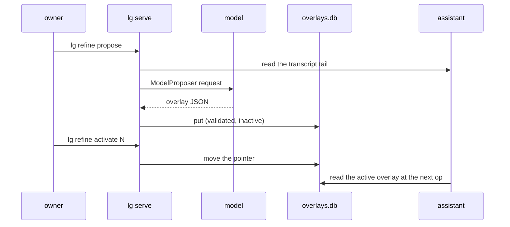

# ADR 0013: The refine loop

## Status

Accepted, 2026-11-10. Amended 2026-11-25: an activation can name the
pointer it read, and it moves only when no move came in between.
Amended 2026-11-26: `overlay_active` names the head of its move.

## Context

The assistant runs on one profile: the system prompt of the config, its
tools and its bounds. An owner who sees the assistant answer badly edits
the config and restarts the daemon. The engine has a better tool for this.
A profile overlay is a versioned change to a profile: a new system prompt,
guardrails, tool guidance, skills or tighter bounds. A store keeps each
version, and a pointer names the active one. A durable agent reads the
active overlay at the start of each op, so a change needs no restart.

The engine also ships a refine workflow, `agent_refine`. It reads ended
runs, asks a proposer for candidate overlays, composes them, probes each
one by replay and picks a winner. littleguy cannot use it as it stands:

- Its replay probe reads `agent_loop` runs only. The assistant is the
  durable agent `assistant/<owner>`, and `run_start` refuses such a run
  as `SourceNotReplayable`.
- It needs an `OverlayComposer`, and the engine ships none.
- It registers only under the agent feature `eval`, which turns on
  `autumn-harvest/testing`. A daemon should not ship test support.

## Decision

- **The overlay store is real; the refine workflow waits.** A `[refine]`
  section gives the assistant harness a `SqliteOverlayStore` in
  `overlays.db`, next to `lg.db`. The harness itself validates each
  overlay, so a version above the ceilings of the refine policy is never
  stored or activated.
- **One proposer call, outside a workflow.** `lg refine propose` reads the
  last `messages` messages of the assistant transcript (40 by default;
  ADR 0034 removed a bound of 500 and of 64 KiB). It asks the engine `ModelProposer`, over
  the model of the assistant, for one overlay of the configured dimension.
  A reply that does not decode, or does not fit the ceilings, goes back
  with its reason, up to three attempts. `KEEP_BASE` stores nothing.
- **The owner activates each version.** A proposal is stored as an
  inactive version by the operator `lg-refine`. Only the owner moves the
  pointer: with `lg refine activate`, on the web pages, or as a program
  on the owner's socket (see below). `lg refine rollback` moves it back.
  There is no auto adoption, so the engine's daily cap and approval
  timeout do not apply yet.
- **An activation can name the pointer it read** (amended 2026-11-25).
  A program that owns the daemon, such as a game that refines its
  characters, reads `overlays` and then activates. A person can roll back
  or activate on the web pages in between, and the person's choice must
  win. So `overlays` also answers `head`, the `seq` of the last move of
  the pointer, read with the active version from the same log row. And
  `overlay_activate` takes an optional `expected: {"active": A, "head":
  H}`, copied from that answer. Both keys
  are required, and `null` means no active version or no move yet, as in
  `overlays`. The daemon calls the store's `activate_guarded`, which
  checks both in the swap transaction. Any move after the read refuses
  the activation, also a move away and back to the same version, because
  each move raises the head. A refusal is `overlay_moved` with the
  pointer as it is now, and nothing changes. A guarded move answers
  `overlay_active` with `guarded: true`. An older daemon drops
  `expected` and moves the pointer unchecked, so a caller that sent
  `expected` and gets no `guarded` knows that the move was not checked.
  With no `expected`, the daemon reads the pointer itself just before
  the swap, as before, and a move after the caller read `overlays` goes
  unseen. `lg refine activate` and the web pages send no `expected`: a
  person acts on the page in front of them.
- **An activation answer names the head of its move** (amended
  2026-11-26). The owning program stores the pointer of its own move,
  and on its next pass it compares that with `overlays`. A person who
  moves away and back leaves the same version active, so only the head
  shows the move. A second read of `overlays` after the move races such a
  move, so `overlay_active` carries `head`: the `seq` of the move that
  it reports, or the head as it stands when the version was already
  active and nothing moved. `overlay_rollback` answers the same. The
  caller stores it and compares it with the next `overlays.head`. The
  engine store returns no `seq` from a swap, so the daemon reads the
  pointer again right after the swap, in the same job. The loop runs one
  job at a time, but another process on the same `overlays.db` can move
  in between. The store numbers the moves of a kind 1, 2, 3 and so on, so
  the daemon answers the head only when the version is the one just made
  active and the head is one past the head before the swap, or the same
  head for no move. Otherwise the answer leaves `head` out, so it never
  names the head of a later move. A read after the swap that fails also
  leaves `head` out, with a warning in the log. The move has committed,
  so the answer is still `overlay_active`. An error would invite a
  retry: a retried rollback moves one version further, and a guarded
  retry gets `overlay_moved` for its own move. The field is optional:
  an older reader ignores it, and an older daemon leaves it out. A
  caller with no `head` reads `overlays` again and loses only the check
  of a move away and back in between.
- **The owner can write a version too.** `lg refine put <file>` stores an
  overlay JSON file. `{}` is the config profile with no change, so an owner
  turns every overlay off by putting and activating it.
- **Every command goes through the daemon.** The daemon holds the store,
  so the socket checks that the owner sends each request, as it does for
  approvals.
- **The feature `refine` is on by default.** It adds no crate. The store
  opens only with a `[refine]` section, so a config without one runs as
  before, with no overlay read per op.

## Consequences

- A proposal is as good as one model call over the transcript. Nothing
  replays it before the owner sees it. The owner reads it with
  `lg refine show` and decides.
- The transcript can hold private data. The proposal goes to the model of
  the assistant, which saw the same data. An overlay can quote that data
  into the system prompt, and the owner sees it before activation.
- When the engine probes durable agent runs and ships a composer outside
  `eval`, `lg refine` can start the `agent_refine` workflow instead. The
  store, the commands and the activation stay as they are.
