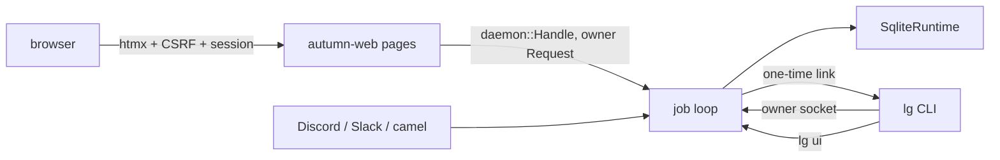

# ADR 0014: `lg serve` is an autumn-web app

## Status

Accepted, 2026-11-10.

## Context

`lg serve` grew its own shell: a Unix socket loop, a job queue, signal
handling and shutdown. M5 asks for web pages over the same controls that
`lg` has: chat, approvals, pairing, refine overlays and connections.
autumn-web is the house framework. It brings the HTTP server, sessions,
CSRF, security headers, htmx, maud, health and a graceful shutdown.

The full move would mount `HarvestPlugin` on SQLite, so the plugin owns the
runtime, and the app gets the management API and the Harvest UI. In
autumn-harvest 0.10 that cannot host the durable agent. The plugin's
SQLite driver loads only `#[activity]` definitions from the
`HarvestBuilder`. The agent registers its harness activities on a
`SqliteRuntime` as closures, and its builder path needs the `postgres`
feature. autumn-harvest #2641 asks for a backend-neutral registration.

## Decision

- **`lg serve` runs `autumn_web::app()`.** autumn-web owns the server, the
  signals and the shutdown. The job loop of the daemon runs as a task of
  the app. The shutdown hook stops the loop and waits for it, so the
  runtime closes before the process ends.
- **lg keeps its own `SqliteRuntime`** inside the job loop until #2641
  lands. Then the runtime moves into `HarvestPlugin`, and the pages stay.
- **The pages are maud markup with htmx.** Each action posts with htmx
  and gets back the section that it changed.
- **The pages are a client of the job loop.** A `daemon::Handle` sends each
  action as an owner `Request`, the same one that `lg` sends over the
  socket. The pages hold no state, and they can do nothing that `lg`
  cannot.
- **The pages stay on this machine.** `[ui] bind` must be a loopback
  address. The default is `127.0.0.1:3004`.
- **A person who can use the owner socket signs a browser in.** `lg ui`
  prints a link with a token of 32 random bytes. The token works once,
  for five minutes, and at most eight are live. The login page rotates the
  session id, then marks the owner in the session.
- **autumn-web guards each request.** The session cookie is HTTP-only and
  same-site strict. Each mutating request needs the CSRF token. The page
  sends it in `hx-headers`. The default security headers stay on,
  including the content security policy.
- **lg keeps its own config and logs.** A fixed `ConfigLoader` builds the
  autumn-web settings from `lg.toml`, so no `autumn.toml` is read. A quiet
  `TelemetryProvider` leaves the `LG_LOG` subscriber in place. The
  pre-stop grace is 0, because no load balancer sits in front. The
  answer-engine documents, such as `llms.txt`, are off.

## Consequences

- autumn-web is a dependency of every build, with only its `maud` and
  `htmx` features. The built-in health, metrics and info routes also
  serve on the loopback address.
- The pages do not refresh by themselves. A section reloads after each
  action on it.
- When #2641 lands, `lg serve` mounts `HarvestPlugin` and drops its own
  runtime. The socket, the pages and the `Request` protocol stay.
