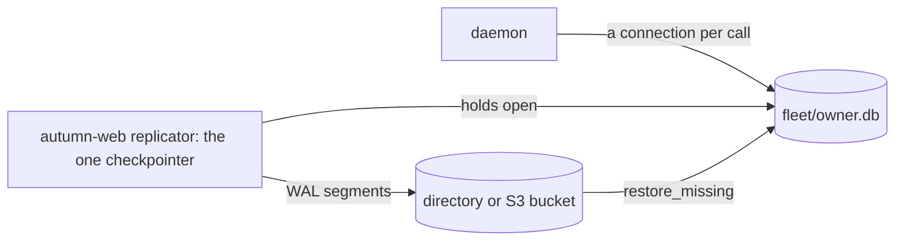

# ADR 0017: The tenant database on a fleet

## Status

Accepted, 2026-11-11.

## Context

A Fly Sprite can lose its volume. littleguy keeps the memory, the episode
log and the approvals in `memory.db` beside `lg.db`, so a lost volume loses
them all. The owner asked for a fleet: many owners per host, and a failover
to another host. The Claude Doc "littleguy on a fleet: design" plans six
milestones, F1 to F6. F1 needs no engine change.

autumn-web 0.10 has a SQLite fleet (its ADR 0019). It keeps one database
file per tenant, ships the WAL of each open file to object storage, and
restores a missing file at its open. The fleet needs the `sqlite` feature
of autumn-web. That feature changes the pool type of the whole app, and
autumn-harvest-plugin 0.10, which the `camel` feature uses, then fails to
build. autumn-harvest #2641 fixes the plugin, and it ships in 0.11.

The replicator under the fleet ships one file, and it builds without the
`sqlite` feature. A replicated file has rules:

- Only the replicator checkpoints. Each connection runs with
  `wal_autocheckpoint = 0`.
- The connection of the replicator closes last. SQLite checkpoints at the
  close of the last connection.

The stores of littleguy use rusqlite. autumn-web uses diesel. Both link the
same `libsqlite3-sys` 0.38, so one SQLite library runs in the process, and
its locks see both.

Two other stores keep a connection open for their whole life: the refine
overlay log of autumn-harvest-agent and the San Mateo store. Neither can
take a connection factory today, so neither can follow the rules.

## Decision

- **A `[fleet]` section, behind the feature `fleet`.** `lg serve` keeps
  the stores in `<root>/<owner>.db`, and runs the replicator of autumn-web
  on it, on its own thread. The root defaults to `fleet` beside `lg.db`.
  The owner name must be a tenant name of the autumn-web fleet, so F2 can
  open the same file through `DatabaseFleet` on autumn-web 0.11.
- **The replica is a directory or an S3-compatible bucket.** R2, S3 and
  Tigris all fit. The keys come from the environment only, through
  `access_key_id_env` and `secret_access_key_env`. The RPO defaults to
  30 s, so the replicator ships every 15 s. Each owner has its own key
  prefix, `littleguy/tenants/<owner>`.
- **The stores open a connection per call.** `SqliteStores::open_shared`
  opens the tenant file for each call, with the checkpoint off, and closes
  it before the call returns. The connection of the replicator holds the
  WAL open, so no close of the stores is the last one. A test proves that
  the WAL keeps its frames over 1,200 writes.
- **The first start moves `memory.db`.** When the tenant database holds no
  row of the stores, the daemon copies each table of `memory.db` into it in
  one transaction. The old file then takes the name `memory.db.imported`,
  so the owner can go back.
- **The replicator opens first.** `lg serve` creates the file in WAL mode,
  then runs the first tick, which opens the connection of the replicator.
  Only then does the daemon open its stores.
- **A stop ships the last writes.** The daemon stops first. Then the
  replicator ships the last frames, and its connection closes last.
- **`restore_missing` is off by default.** With it on, a new volume
  restores the tenant file from the replica. Nothing fences another host
  yet, so two hosts with the same owner and replica can diverge. F5 adds
  slot ownership and fencing.
- **Two stores stay out.** The refine overlay log stays in `overlays.db`
  (autumn-harvest #2656) and San Mateo stays in `san-mateo.db`
  (san-mateo #10). `lg.db` stays on its own until F2 runs the agent per
  tenant (autumn-harvest #2649).

## Consequences

- A lost volume loses at most the RPO of memory, episodes and approvals,
  when `restore_missing` is on.
- The fleet feature adds diesel, the Postgres backend and the S3 client of
  autumn-web to the build. The replication module needs a database
  backend. The feature stays out of the default features.
- F2 replaces the single-file replicator with `DatabaseFleet` and
  `HarvestPlugin::sqlite_per_tenant` on 0.11. The file name stays.
- The refine overlays, the OAuth connections and the runtime state still
  live on the volume only, until the engine asks land.
