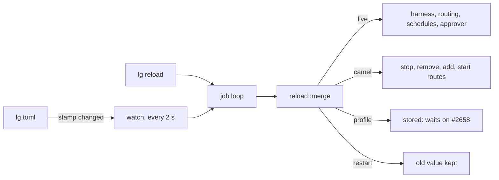

# ADR 0018: Reload the config without a restart

## Status

Accepted, 2026-11-11.

## Context

`lg serve` read `lg.toml` once, at its start. The owner wants to add a
camel route, allow a new Discord sender or change a schedule while the
daemon runs. A restart drops the open channel connections and the camel
context, so it is a poor way to change one line.

Most sections only shape the harness, the routing table, the schedules
and the camel routes. The daemon builds each of them from the config, and
it can build them again. A few sections start something at start: a
server, a socket, a backend or a database file. Those cannot change
without a restart.

autumn-harvest reads the agent profile once per run and records it in the
history. A run on SQLite never ends, so a new `system`, `window` or `tools`
never reaches the running assistant. This is true after a restart too,
because the run resumes from its history. autumn-harvest #2658 asks the
engine for a way to read the profile again.

## Decision

- **A pure kernel decides.** `littleguy_core::reload::merge` compares the
  running config with the new file. It returns the config to run and three
  lists of section names, in file order.
- **Live sections apply now.** `discord`, `slack`, `camel`, `memory`,
  `brief`, `approvals`, `flow` and `refine`. The daemon builds the harness,
  the routing table, the schedules and the approver again, and registers
  the harness under the same names.
- **Profile sections are stored, and the reload names them.** `system`,
  `window` and `tools` go into the running config. The running assistant
  keeps the profile of its run until autumn-harvest #2658 lands.
- **Restart sections keep their old value.** `owner`, `san_mateo`,
  `google`, `sandbox`, `mcp`, `ui`, `hooks` and `fleet`. The reload names
  each one that changed, so the owner knows to restart.
- **Camel routes change in place.** The camel context adds a route after
  its start. A reload stops and removes each route that is gone or
  changed, swaps the mapper, then adds and starts each new route. A daemon
  with no route starts camel at the first reload that adds one.
- **A bad file changes nothing.** The daemon parses the file, checks each
  new camel route and builds the new harness before it swaps anything. On
  an error it answers with the error and keeps the running config.
- **Two triggers.** A watch reads the size and the modification time of
  the file every 2 s and sends a reload when either changes. `lg reload`
  sends one at once and prints the answer. Only the owner may reload.

## Consequences

- A new route, sender, schedule or flow rule applies within 2 s of a save.
- A changed system prompt does not reach the assistant until the engine
  reads the profile again. The reload says so.
- A route that changes stops and starts again, so an exchange in flight
  on it can end early.
