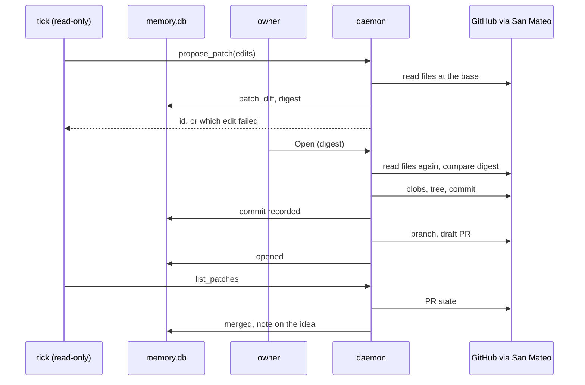

# ADR 0042: littleguy proposes patches, and the owner opens them as draft PRs

## Status

Accepted, 2026-11-18.

## Context

littleguy finds defects in its own source and writes the fix. On the
owner's daemon, about ten fixes wait as notes (`patch-set`, `patch-31` and
others). Each note holds prose and code, an apply order and checks. None of
them can leave the note store. A person must read the note, copy the code
and open a PR. Idea #24 says the same of the plan store: work goes in and
never comes out.

Five facts shape the design:

- **Almost all of this work happens on a tick.** A tick is read-only. The
  engine refuses a `Write` or `External` call there. An `Internal` call
  runs (ADR 0029).
- **Every patch run reads outside text.** littleguy reads its own source
  with `web_fetch` and `api_get`. Both carry `untrusted_input`. A page
  could steer a patch.
- **The repository is public.** A PR is a publication. A run that read
  outside text and private data could put that data in a diff or a PR
  body. That is the lethal trifecta of ADR 0009.
- **A credential never reaches a guest.** Code in `run_code` cannot hold
  a token (ADR 0031, ADR 0032). It can still read and write `memory.db`
  (autumn-harvest#2697).
- **San Mateo already brokers GitHub.** An owner catalog can add a
  provider in `API_KEY` mode (ADR 0031). The proxy waits on a rate-limit
  answer. San Mateo has no GitHub App mode.

`api_send` on a GitHub connection can already open a PR in a conversation.
It takes about six calls, each one waits for the owner, and a tick can do
none of them.

## Decision

Split the decision from the effect, as skills do (ADR 0024). The model
proposes. The owner opens. Daemon code, not a model, does the GitHub work.

### The model proposes

- **`propose_patch`** is `Internal`, so a tick may call it. It takes a
  title, a body, an optional `base` commit, a list of edits, an optional
  `revises` and an optional `goal` or `idea`.
- **An edit is exact.** `{path, old, new}` replaces the one occurrence of
  `old`. `{path, create}` writes a new file. `{path, delete: true}`
  deletes one. The edits apply in order. A model writes a correct exact
  replacement far more often than a correct unified diff. Overlapping
  matches count as two, so an edit never lands in the wrong place.
- **The tool checks the patch at once.** It reads each file at the base
  through the patch connection and applies the edits
  (`patches::edit::apply`). A failure names the edit and the reason, so
  the model learns on the same tick that the patch does not apply. Without
  `base`, the tool uses the head of the base branch.
- **The store keeps the proposal** in `memory.db` (schema 10): the edits,
  the base, the diff, its digest and a status. The status is `waiting`,
  `declined`, `withdrawn`, `opened`, `merged` or `closed`. At most 20
  patches wait. That bound is on the agent, as for skill drafts.
- **`read_patch`** returns one patch whole. **`list_patches`** lists them,
  and reads the state of each open PR first. A merge or a close ends the
  patch, and adds a note to the goal or the idea that it served. So a
  patch leaves the queue, and its outcome comes back (idea #24).
- **`withdraw_patch`** closes a waiting patch.
- **No tool opens, pushes, comments, marks ready or merges.**

### The owner opens

- **The Patches tab** of the workspace page shows each patch as a diff,
  with its title, its body and two buttons: Open draft PR and Decline.
  `lg patches`, `lg patch show <id>`, `lg patch open <id>` and
  `lg patch decline <id>` do the same. `lg patch open` prints the diff
  and asks first.
- **The owner opens exactly what the owner read.** The digest is SHA-256
  over the title, the body, the base and the diff. The press carries the
  digest on the page. The daemon applies the edits at the base again,
  and refuses when either digest differs. Code in `run_code` can write
  `memory.db`, so a row can change between the read and the press. The
  digest makes that change fail.
- **Every patch waits for the owner.** The council (ADR 0027) and the
  reviewer (ADR 0037) never open a PR. Every patch run reads outside text
  in practice, and a PR is an outward effect on a public repository.

### The daemon does the GitHub work

On Open, the daemon calls the REST API of git data through the San Mateo
proxy. It needs no git binary and no checkout:

1. It reads the tree of the base commit, for the mode of each file.
2. `POST /git/blobs` for each changed file.
3. `POST /git/trees` with `base_tree`.
4. `POST /git/commits` with the base as its parent.
5. `POST /git/refs` for `refs/heads/littleguy/patch-<id>-<title>`.
6. `POST /pulls` with `draft: true`, into the base branch.

The commit is recorded before the branch is made. A second press after a
failure resumes from the recorded commit. It finds the branch and the PR
that are there, so it never opens a second PR.

A revision (`revises: <id>`) of an open PR is written against the head of
that PR's branch. On Open, the daemon moves the branch forward with
`PATCH /git/refs/...` and `force: false`. When the branch moved since the
revision was written, nothing is pushed, and littleguy proposes it again.

### Guards that code enforces

- **One repository, one base branch, a short list of calls.**
  `patches::github::allowed` lists each method and path that a patch
  needs. The client refuses any other call. No path of the code can merge,
  mark ready, comment, review, delete a branch or force-push.
- **No edit under `.github/`, and no path out of the tree.** The path
  kernel `littleguy_core::patch_path` refuses an empty, absolute or
  `..` path, a `.git` segment and a first segment of `.github` in any
  case. `formal/verus/src/patch_path.rs` proves that the kernel is that
  reading. The token also lacks the Workflows permission, so GitHub
  refuses a workflow edit too.
- **No house key in a patch.** The tool and the open refuse a title, a
  body or a diff that holds the value of a house key (ADR 0040).
- **A warning on build files.** An edit of a `Cargo.toml`, a `Cargo.lock`,
  a `build.rs`, `xtask/`, the toolchain file or the image shows a warning
  on the Patches tab. It is not refused, because some fixes need it.
- **The API tools never get the patch integration.** `[api]` without a
  list takes every integration except the one of `[patches]`. A list
  that names it fails at load.
- **Merge stays with a person.** A ruleset on the base branch requires
  the owner's review.

### The credential

The patch connection is a `[[san_mateo.integration]]` on a catalog provider
`github-pat` in `API_KEY` mode. The README shows the catalog entry. The
token is a fine-grained personal access token for one repository, with
Contents and Pull requests read and write and Metadata read. San Mateo
keeps it. It never reaches a tool result, a log, the model or a guest.

The owner chose a token of the owner's own account. So each commit and PR
carries the owner as its author. The PR body and the commit message say
that littleguy proposed the patch, with its id.

### Config and feature

```toml
[patches]
integration = "littleguy-pr"
repo = "autumn-foundation/littleguy"
base = "main"                     # the default
```

The `patches` feature holds it. It needs `api`, and `full` turns it on. A
`[patches]` section in a build without it fails at start.



## Consequences

- A fix that littleguy writes on a tick reaches a draft PR with one press.
  CI runs on it as on any PR. CI is the compile check. A red check comes
  back to littleguy through its own reads, and it proposes a revision.
- The owner reads each diff before it is public. That is the gate against
  a steered patch and against private data in a public PR.
- No engine change is needed. The feature uses the existing proxy.
- GitHub limits are far away. An open costs one call per changed file
  plus five. The owner's presses set the rate, and the proxy waits on a
  rate-limit answer.
- The base can move after a patch. GitHub shows a conflict on the PR, and
  littleguy proposes a revision.
- Every PR shows the owner as its author, because the token is the
  owner's. A bot account or a GitHub App would change that. A GitHub App
  mode in San Mateo is later work.
- A notice in Discord or Slack for a new patch is later work. The tool
  tells the assistant to say that a patch waits.
- CI holds no secrets today. A later job that needs a secret must not run
  for a `littleguy/` branch.
