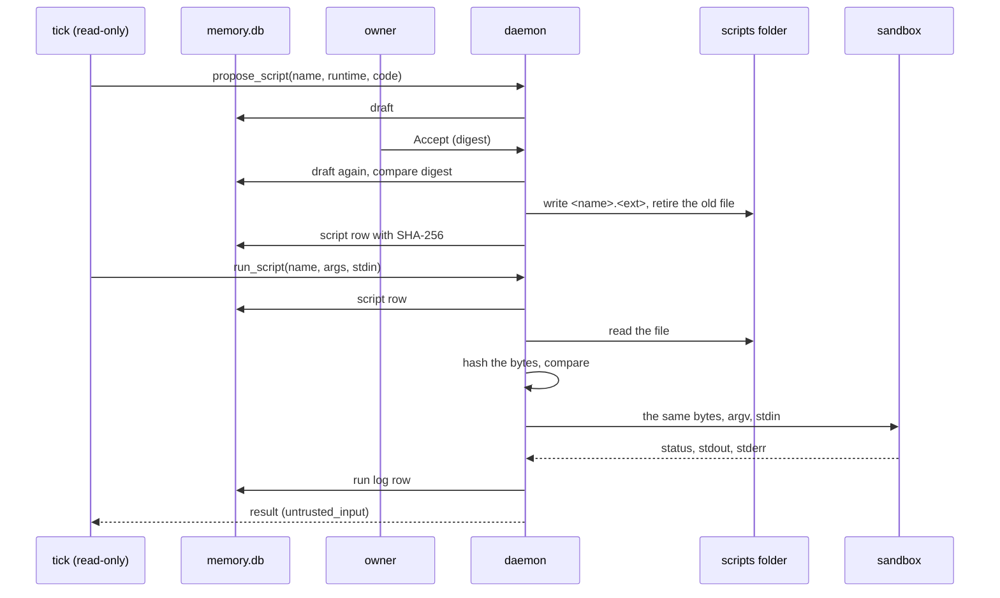

# ADR 0045: Saved scripts that a tick can run

## Status

Accepted, 2026-11-23. It amends ADR 0021: a tick changes nothing except
through a script that the owner accepted.

## Context

A tick cannot call `run_code`, and that is correct. `run_code` is `Write`
or `External` (ADR 0008), and the engine refuses both on a read-only run.
But a tick also cannot run again a program that the owner already read.
So each tick writes the same work again from nothing. On 2026-11-23 one
walk of a remote repository cost 3 fetches and about 19 000 characters
of tool results. A saved program of 40 lines would cost one call and a
few hundred characters.

Four facts shape the design:

- **The engine runs only `ReadOnly` and `Internal` tools on a tick**
  (ADR 0021, ADR 0029). A tool that must run on a tick must declare one of
  the two. The engine believes the declaration. It cannot see what a
  program does.
- **Skills split the decision from the effect** (ADR 0024). The model
  drafts, the owner accepts on the Workspace page, and the daemon writes
  the file. A patch works the same way (ADR 0042).
- **Code in the sandbox can write `memory.db` and the folders next to the
  config** (ADR 0032, autumn-harvest#2697). It cannot act as the owner on
  the socket, and it cannot write `lg.toml`.
- **A tick reads outside text.** A page that a tick read can steer the
  model. The model then chooses the arguments of a call.

The owner settled three questions on 2026-11-23:

- Acceptance lives on a new Scripts tab, not on the Skills tab. Accepting
  prose and accepting code to run are different promises.
- A script is trusted whole once the owner accepts it. It gets no list of
  capabilities. "You break it, you buy it."
- The tick rule of ADR 0021 changes, and the change is written down here,
  not discovered later.

## Decision

### The model proposes

- **`propose_script`** is `Internal`, so a tick may call it. It takes a
  name, a sandbox runtime, a description and the code. It stores a draft
  in `memory.db` (schema 11). A draft with the name of a waiting draft or
  of an accepted script revises it. At most 20 drafts wait. That bound is
  on the agent, as for skill drafts.
- **A name is one plain file name.** It has 1 to 64 bytes of `a`-`z`,
  `0`-`9` and `-`, and it does not start with `-`. So it never holds `/`,
  `.` or `\`, never names the retired folder, and never reads as a flag.
  `littleguy_core::script_name` is the kernel, and
  `formal/verus/src/script_name.rs` proves that reading.
- **A runtime is one of the sandbox**: `python3`, `node`, `bash` or `sh`.
- **`list_scripts`** names the accepted scripts and the drafts.
  **`read_script`** returns the code of a script and of its waiting draft,
  so a revision starts from the current code. Both are `ReadOnly`, and
  both carry `untrusted_input`, because a draft can hold text from a page.
- **No tool accepts, declines or retires a script.** The council (ADR
  0027) and the reviewer (ADR 0037) never accept one either.

### The owner accepts

- **The Scripts tab** of the Workspace page lists the drafts, then the
  accepted scripts. A draft shows its code, a warning that a heartbeat may
  run it, and Accept and Decline. A script shows its code, its hash and
  Retire. `lg scripts` and `lg script show|accept|decline|retire` do the
  same. `lg script accept` prints the code and asks first.
- **The owner accepts exactly what the owner read.** The digest is the
  SHA-256 of the name, the runtime, the description and the code, each
  with its length first. The Accept press carries the digest on the page.
  The daemon recomputes it and refuses a draft that changed. Code in a run
  can write `memory.db`, so a draft can change between the read and the
  press.
- **Acceptance writes the file and pins it.** The daemon writes the code to
  `<dir>/<name>.<ext>`, with the extension of the runtime, such as
  `walk-repo.py`. It records the SHA-256 of those bytes in `memory.db`.
  An older file of the name moves to `<dir>/.retired/` first. Nothing is
  deleted. `dir` is `[scripts] dir`, or `scripts/` next to the config
  file, as for skills.
- **Retire** removes the row, so `run_script` refuses the name, and moves
  the file to `.retired/`.

### A tick runs it

- **`run_script` is `ReadOnly`**, so a tick may call it, with no approval
  in a conversation either. It takes a name, `args`, `stdin` and an
  optional `timeout_ms`.
- **It runs only an accepted name.** Any other name, and a file that the
  owner never accepted, is refused before the sandbox starts.
- **It verifies the pin on the bytes it runs.** It reads the file once,
  hashes those bytes, and sends those same bytes to the sandbox as the
  code. A hash that differs from the recorded one refuses the run. So no
  change lands between the check and the run.
- **Arguments are argv and stdin only.** Each item of `args` is one argv
  entry after the code file. `stdin` is the stdin. No shell string is
  built from them. A tick's web text can reach the arguments, and a shell
  string would let it reach a command. A test sends `$(touch x)` and
  `` `id`; rm -rf / `` and checks that each one arrives as one plain argv
  entry.
- **It runs on the backend of `[sandbox]`.** `[scripts]` needs a
  `[sandbox]` section, and the config load says so. `[scripts] network`
  sets the network of the scripts. It is the network of `[sandbox]` by
  default. The scripts get their own sandbox runtime at start, so
  `run_code` keeps its own network setting. Each run starts clean and
  gets no workspace and no environment of the daemon.
- **The result carries `untrusted_input`.** A script can fetch a page, so
  its output marks the conversation, as `web_fetch` does (ADR 0033, ADR
  0036).
- **Each run goes in a log** in `memory.db`: the name, the arguments, the
  stdin, the run of the assistant, the outcome and the time. A refusal of
  an accepted name for drift goes in the log too. A retried call logs
  once. The log keeps the newest 500 rows, as the tick log does. The
  Scripts tab shows the newest 50 under the list.

### The amended tick rule

ADR 0021 said that a tick changes nothing. The engine enforces that by the
effect of each tool. `write_file` is `Write`, so the engine refuses it on a
tick, and a tick loses the change. `run_script` is `ReadOnly` so that a
tick can call it. So a blessed script keeps its side effects where a
`write_file` call loses them: a file it writes in a process sandbox, a
POST it sends with the network on.

The rule is now: **a tick changes nothing except through a script that the
owner accepted.** The owner accepts that when they accept the script. The
run log on the Scripts tab makes each use of the exception visible, with
its arguments.

### What the hash pin protects

The pin protects against **drift** between acceptance and a later run: a
file edited by hand, a bad copy, a sync tool, a revision that did not go
through the tab. Such a file does not run, and the tab marks it as
changed.

The pin does **not** protect against a hostile tick. Code in the sandbox
can write `memory.db` and the scripts folder (ADR 0032,
autumn-harvest#2697). So it can write a new file and a matching hash, and
no pin can be kept out of its reach. The real fix is a mount namespace for
each run in the engine. The pin is still worth keeping: it is cheap, and it
turns every accidental change into a refusal that the owner sees.

### Config and feature

```toml
[sandbox]
backend = "process"

[scripts]
dir = "~/notes/scripts"   # optional; scripts/ next to lg.toml by default
network = true            # optional; the [sandbox] network by default
```

The `scripts` feature holds it. It needs `sandbox`, and it is on by
default (ADR 0026). A `[scripts]` section in a build without it fails at
start and at a reload. `[scripts]` starts a sandbox runtime, so a change
applies at the next start. The image makes `scripts/` next to the config
and gives it to `lg`, as it does `skills/`, and `cargo xtask container`
checks that.



## Consequences

- A walk that a tick repeated costs one call and a few hundred characters
  once the owner accepts it.
- A tick can now change the world, but only through code that the owner
  read and accepted, and the run log shows each such run.
- A script that writes files keeps them only in a process sandbox. A
  Firecracker run starts clean and returns no files, so there a script
  changes the world only through the network.
- A research source run (ADR 0044) runs read-only tools, so it may call
  `run_script` too. The same rule holds there.
- The owner reviews a script once, not each run. A script that does harm
  with some arguments does that harm when a page picks those arguments.
  Write a script that treats its arguments as data, as the tool does.
- A Discord or Slack notice for a new draft is later work. The tool tells
  the assistant to say that a draft waits.
- The pin becomes a real guard only with a mount namespace for each run
  (autumn-harvest#2697).
