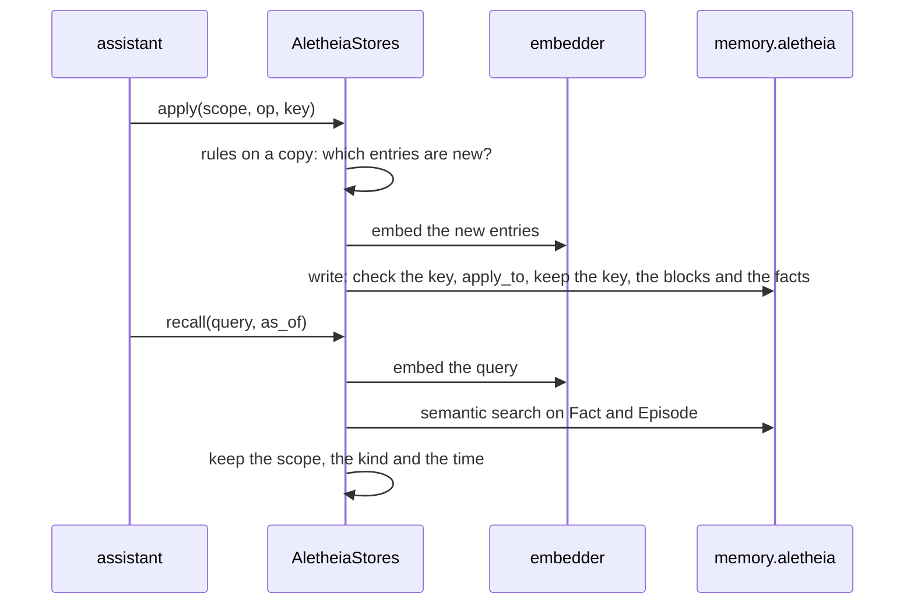

# ADR 0047: Memory on AletheiaDB

## Status

Accepted, 2026-11-27.

## Context

The memory blocks and the episode log live in `memory.db` (ADR 0005). A
block goes into every prompt in full, and it has a size limit. So the
assistant forgets what does not fit: an entry that a later edit replaced
or removed, and an episode that the log evicted. It also has no way to find
an old fact by its meaning. A word search only finds the exact words.

[AletheiaDB](https://crates.io/crates/aletheiadb) is a bi-temporal graph
database with an HNSW vector index. Each node keeps every version, with the
time when it was true. `autumn-plugin-aletheiadb` 0.1 embeds it in an
autumn-web app and runs each call on a blocking thread.

`sqlite-vector-rs` was the first choice. It cannot link: it pins rusqlite
below 0.40, and autumn-web needs `libsqlite3-sys` 0.40. Its `register`
also loads a shared library at run time with `unsafe`.

The engine asks two things of a memory store:

- `MemoryStore::apply` keeps the edit key and the first result of the edit,
  an error included, in the same transaction.
- An `EpisodeLog` is one value with private fields. Each change is one
  transaction.

The plugin 0.1 has no call that writes more than one thing at once, so this
ADR adds `AletheiaDb::write` and `AletheiaDb::read` to it, in 0.1.1. A
reopened directory also failed to build its vector index, so 0.1.1 adds
`rebuild_vector_index` too.

AletheiaDB has three limits that shape the layout:

- One node keeps at most 1 000 versions. An update in place adds one.
- One transaction holds at most 50 000 operations.
- Its as-of vector search needs a temporal vector index. That index takes
  snapshots, and a rebuild at a reopen skips it.

## Decision

- **The memory and the episode log move to AletheiaDB.** A directory
  `memory.aletheia/` beside `lg.db` holds them. `memory.db` keeps all the
  other tables: approvals, sent reports, goals and ideas, notes and the
  rest.
- **`[memory] backend` picks the store.** `aletheia` is the default when
  the `aletheia` feature is in the build and no `[fleet]` is set. `sqlite`
  keeps the old store. A config that asks for `aletheia` in a build
  without the feature fails `lg serve` at start.
- **The engine owns the rules.** A memory edit calls `memory::apply_to`
  and an episode change calls `EpisodeLog`, as in the SQLite store. One
  `AletheiaDb::write` keeps each result. A property test runs random edits
  on this store and on the engine's in-memory stores, and asserts the same
  answers.
- **One writer.** A store-wide lock runs the writes one at a time. A write
  transaction of AletheiaDB does not refuse two writers that each create a
  key that the other one looks for. The file `memory.aletheia.lock` keeps a
  second process out, because AletheiaDB does not lock its directory.
- **The graph.** Each node has its label in `kind` and its scope in
  `scope`, so a lookup by either one lists the nodes.

  | Label | One per | Holds |
  |---|---|---|
  | `MemoryScope` | scope | the blocks as one JSON value (small: each block has a limit) |
  | `Fact` | version of an entry | the block, the text, the flow labels, an embedding |
  | `EditKey` | memory edit key | the key, the error or none, a sequence number |
  | `EpisodeLog` | scope | the generation, the drop count, the next sequence number |
  | `Episode` | episode | the text, the time, how the op ended, an embedding |
  | `LogEntry` | episode in the log | the episode id, the consolidated flag, its place |
  | `LogKey` | key of the log | the key and its place |
  | `Derived` | derived fact hash | the hash and its place |
  | `EpisodeClear` | scope | the key of the last clear and what it cleared |

  - A node that changes at each op, `MemoryScope`, `EpisodeLog` and
    `EpisodeClear`, gets a new node for each version, and the old node is
    retracted. So no node gains a version per edit, and none reaches the
    cap of 1 000.
  - The store compares the blocks before and after an edit. An entry that
    appears gets a `Fact` node. An entry that goes away keeps its node: the
    store sets `ended_ms` and takes away its `live` key, so no later edit
    finds it as an entry. A replace links the new `Fact` to the old one in
    `replaces`.
  - The episode log is split up, so a change writes only what changed. The
    log grows by one episode per op, and a node keeps every version. One
    value would write the whole log again for each op.
  - An `Episode` node stays when the log evicts its episode. Only its
    `LogEntry` goes. So the assistant can recall an episode that a
    consolidation pass never saw.
  - A memory clear retracts the facts and the keys of its scope. An
    episode clear retracts the episodes, the entries, the keys and the
    hashes of its scope. A retracted node leaves the vector index, so a
    recall finds no cleared fact, not even as of a past time.
  - The edit keys keep the bound of the SQLite store, 4 096 for each scope.
- **Embeddings.** `[memory.embeddings]` names an endpoint that speaks the
  OpenAI `/v1/embeddings` API, a model, the dimensions and a house key for
  the bearer token. OpenAI, OpenRouter, Ollama and llama.cpp all speak it.
  With no section, a local hashing embedder of 256 dimensions runs. It
  finds shared words, not meaning, and needs no network.
  - The store embeds before it writes. An edit runs the rules on a copy,
    embeds each new entry, then takes the lock and writes. An embedding
    that fails leaves the node without one. The edit still lands.
  - An index pass at each start embeds each node that has no embedding.
  - The directory records the embedder and its dimensions. A start with
    other dimensions fails, with a message that names
    `memory.embeddings.dimensions`. Another model of the same dimensions
    embeds every node again at start.
- **The `recall` tool.** It embeds a query and returns the closest facts
  and episodes, with their scores, their times and whether each is still
  current. The facts live in the scope `agent:<id>` and the episodes in
  `agent:<id>:episodes`, as the engine names them. An `as_of` time keeps
  the facts that were added before it and had not ended, and the episodes
  before it. So the assistant can find an entry that it replaced in March.
  The filter reads `added_ms`, `ended_ms` and `at_ms`, not the as-of search
  of AletheiaDB, because its temporal index does not survive a reopen. The
  `aletheia` feature holds the tool.
- **The first start moves the memory.** When the directory holds no
  scope and `memory.db` holds memory rows, the store copies each scope,
  each edit key, each episode log and each episode clear, in one
  transaction. A `Meta` node records the move, so it runs once. The rows
  stay in `memory.db`, so `backend = "sqlite"` goes back to the memory as
  it was before the move. A full `memory.db` is about 15 000 operations,
  well below the cap of 50 000.
- **A reload resizes the blocks soon.** The assembly of the daemon cannot
  wait, so a reload sets the sizes of new scopes at once, and a task
  resizes the stored ones. A change of `backend` or `[memory.embeddings]`
  applies at the next start.
- **Not on a fleet yet.** `[fleet]` replicates one SQLite file (ADR 0017).
  The plugin's `fleet` feature replicates an AletheiaDB directory on the
  autumn-web database fleet, which F2 brings. Until then `backend =
  "aletheia"` with a `[fleet]` fails `lg serve` at start, and names
  `memory.backend`.

## Consequences

- A replaced or removed entry and an evicted episode stay in the file. The
  `recall` tool finds them by meaning.
- A clear tombstones the facts and the episodes: each one gets a
  retraction, and the store and `recall` treat it as gone. Its versions stay
  in the history, because AletheiaDB keeps history immutable by design.
- Each memory edit and each episode costs one embedding call when an
  endpoint is set. A call that fails costs no edit.
- The build gains AletheiaDB and its HNSW index. Without the `aletheia`
  feature, nothing of it compiles.
- AletheiaDB 0.2 does not close the old valid time on an update. The store
  never updates a `Fact` or an `Episode` to change what it says. It sets
  `ended_ms`, an embedding, or the consolidated flag of a `LogEntry`, once
  each, and it reads them only as they are now.
- The node count grows by one for each edit and each op, because each
  version of a scope or a log is a node. A later step can compact old
  versions when the engine gives a way.
- F2 moves the directory onto the fleet through `AletheiaDbFleetPlugin`.
